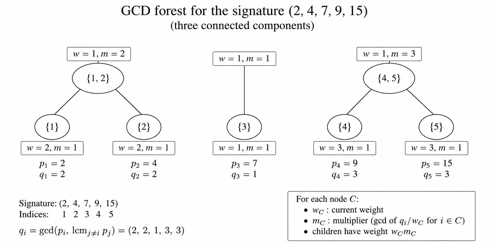

# Fractional Triangles — Lean Verification

Lean 4 verification accompanying the *Fractional Triangles* manuscript.

The repository is organized according to the sections of the manuscript.
For each Lean file below, the README records the corresponding paper content and the part that is checked in Lean.

All current Lean files compile without `sorry`.

## Build

```bash
lake build
```

---

# Section 2 — Grading group and roots

Directory: [`FractionalTriangles/Section2`](FractionalTriangles/Section2)

### [`GradingGroup.lean`](FractionalTriangles/Section2/GradingGroup.lean)

**Section 2 — the Geigle–Lenzing grading group**

Lean constructs


```math
L(p,q,r) = \langle \vec x,\vec y,\vec z,\vec c \mid p\vec x=q\vec y=r\vec z=\vec c \rangle .
```


In particular it verifies the defining relations


```math
p\vec x=\vec c,\qquad q\vec y=\vec c,\qquad r\vec z=\vec c.
```


The dualizing element is defined exactly as in the manuscript:


```math
\vec\omega = \vec c-\vec x-\vec y-\vec z.
```


### [`ScaledDegree.lean`](FractionalTriangles/Section2/ScaledDegree.lean)

Constructs the integral scaled-degree map


```math
D=N\deg, \qquad D(\vec x)=\frac{N}{p},\; D(\vec y)=\frac{N}{q},\; D(\vec z)=\frac{N}{r},\; D(\vec c)=N.
```


### [`Equation22_Generators.lean`](FractionalTriangles/Section2/Equation22_Generators.lean)

**Equation (2.2) — generator checks**

Let


```math
N=\mathrm{lcm}(p,q,r).
```


Lean verifies the scaled degrees


```math
\mathrm{sdeg}(\vec c)=N, \qquad \mathrm{sdeg}(\vec x)=\frac Np, \qquad \mathrm{sdeg}(\vec y)=\frac Nq, \qquad \mathrm{sdeg}(\vec z)=\frac Nr.
```


For each of the four generators it checks equation (2.2):


```math
N\vec v = \mathrm{sdeg}(\vec v)\,\vec c.
```


Equivalently, using the paper's degree normalization,


```math
N\vec v = N\deg(\vec v)\,\vec c.
```


### [`Equation22.lean`](FractionalTriangles/Section2/Equation22.lean)

**Equation (2.2) — all elements of \(L(p,q,r)\)**

The generator calculation is extended to every


```math
\vec v\in L(p,q,r).
```


Lean proves


```math
N\vec v = N\deg(\vec v)\,\vec c.
```

Equation **(2.2)**.


A direct consequence used later is


```math
\deg(\vec v)=0 \Longrightarrow N\vec v=0.
```


Thus every element in the kernel of the degree map is killed by \(N\).

### [`Equation24.lean`](FractionalTriangles/Section2/Equation24.lean)

**Equation (2.4) — quotient by \(\mathbb Z\vec c\)**

Lean constructs the residue map


```math
L(p,q,r) \longrightarrow \mathbb Z/p\mathbb Z \oplus \mathbb Z/q\mathbb Z \oplus \mathbb Z/r\mathbb Z
```


and proves that it is surjective with kernel


```math
\mathbb Z\vec c.
```


Hence the formalized quotient description is


```math
L/\mathbb Z\vec c \simeq \mathbb Z/p\mathbb Z \oplus \mathbb Z/q\mathbb Z \oplus \mathbb Z/r\mathbb Z.
```

Equation **(2.4)**.


Lean also checks the second statement in (2.4):


```math
\vec\omega \longmapsto (-1,-1,-1).
```


Therefore a root equation


```math
\delta\vec\tau=\vec\omega
```


reduces componentwise to


```math
\delta s_p\equiv-1\pmod p,\qquad \delta s_q\equiv-1\pmod q,\qquad \delta s_r\equiv-1\pmod r.
```


### [`Lemma21_Torsion.lean`](FractionalTriangles/Section2/Lemma21_Torsion.lean)

**Lemma 2.1 — torsion mechanism**

From equation (2.2), Lean first proves


```math
\deg(\vec v)=0 \Longrightarrow N\vec v=0.
```


It then verifies the Bézout step


```math
e\vec v=0,\qquad N\vec v=0,\qquad \gcd(e,N)=1 \Longrightarrow \vec v=0.
```


This is the group-theoretic mechanism behind Lemma 2.1.

### [`Lemma21.lean`](FractionalTriangles/Section2/Lemma21.lean)

**Lemma 2.1 — injectivity of multiplication**

For the concrete grading group \(L(p,q,r)\), Lean proves


```math
\gcd(e,N)=1 \Longrightarrow [\;e\;]\colon L(p,q,r)\to L(p,q,r) \text{ is injective}.
```


Equivalently,


```math
e\vec v=0 \Longrightarrow \vec v=0 \qquad \text{when }\gcd(e,N)=1.
```


This is exactly the injectivity used at the end of the proof of Theorem 1.1.

### [`Theorem11_RootCriterion.lean`](FractionalTriangles/Section2/Theorem11_RootCriterion.lean)

**Theorem 1.1 — root index criterion and existence/uniqueness mechanism**

The admissible root-index condition is


```math
\delta\mid k, \qquad \gcd(\delta,N)=1.
```


Equivalently, in the Lean file,


```math
\mathrm{RootIndexAdmissible}(\delta;k,N) \iff \delta\mid k\ \text{ and }\ \gcd(\delta,N)=1.
```


If \(d=d_{\max}\) is the maximal admissible index, Lean verifies


```math
\mathrm{RootIndexAdmissible}(\delta;k,N) \Longrightarrow \delta\mid d_{\max}.
```


Once a maximal root


```math
d_{\max}\vec\varpi=\vec\omega
```


is given, every divisor \(\delta\mid d_{\max}\) produces the root


```math
\vec\tau= \frac{d_{\max}}{\delta}\vec\varpi, \qquad \delta\vec\tau=\vec\omega.
```


Lean also verifies the uniqueness step


```math
[\delta]\colon L\to L\ \text{injective}, \qquad \delta\vec\tau_1=\delta\vec\tau_2=\vec\omega \Longrightarrow \vec\tau_1=\vec\tau_2.
```


Thus, once the concrete necessity and injectivity results from the other
Section 2 files are supplied, the final criterion is


```math
\exists!\,\vec\tau\in L: \delta\vec\tau=\vec\omega \iff \delta\mid k\ \text{ and }\ \gcd(\delta,N)=1.
```


### [`Theorem11_DegreeArithmetic.lean`](FractionalTriangles/Section2/Theorem11_DegreeArithmetic.lean)

**Theorem 1.1 — existence and uniqueness from the maximal root**

Assume that the maximal root satisfies


```math
d_{\max}\vec\varpi=\vec\omega
```


and that


```math
\delta\mid d_{\max}.
```


Lean verifies the existence calculation


```math
\delta \left( \frac{d_{\max}}{\delta}\vec\varpi \right) = \vec\omega.
```


For any other root


```math
\delta\vec\tau=\vec\omega,
```


Lean checks the identity used in the paper:


```math
\delta \left( \vec\tau- \frac{d_{\max}}{\delta}\vec\varpi \right) =0.
```


Using Lemma 2.1 and


```math
\gcd(\delta,N)=1,
```


this gives the uniqueness formula


```math
\vec\tau= \frac{d_{\max}}{\delta}\vec\varpi.
```


The file also isolates the elementary degree implication


```math
k=\delta t \Longrightarrow \delta\mid k.
```


**Input used here:** the construction of the maximal root
\(d_{\max}\vec\varpi=\vec\omega\) is taken as a hypothesis in this file;
its explicit arithmetic construction is handled separately.

### [`Theorem11_MaximalRoot.lean`](FractionalTriangles/Section2/Theorem11_MaximalRoot.lean)

**Theorem 1.1 — equations (2.5), (2.6), and the maximal root**

From the residue congruences


```math
\delta s_p\equiv -1\pmod p,\qquad \delta s_q\equiv -1\pmod q,\qquad \delta s_r\equiv -1\pmod r,
```


Lean proves


```math
\gcd(\delta,p)= \gcd(\delta,q)= \gcd(\delta,r)=1,
```


and hence, for


```math
N=\mathrm{lcm}(p,q,r),
```


```math
\gcd(\delta,N)=1.
```


This is the arithmetic content of equation (2.5).

For equation (2.6), suppose


```math
b_p p\equiv1\pmod d,\qquad b_q q\equiv1\pmod d,\qquad b_r r\equiv1\pmod d.
```


Lean extracts integral coefficients


```math
b_p p-1=dB_x,\qquad b_q q-1=dB_y,\qquad b_r r-1=dB_z,
```


and, assuming


```math
1-b_p-b_q-b_r=dA,
```


checks directly that


```math
\vec\varpi = A\vec c+B_x\vec x+B_y\vec y+B_z\vec z
```


satisfies


```math
d\vec\varpi=\vec\omega.
```


Thus, for \(d=d_{\max}\), this verifies the algebra in the explicit maximal-root
formula (2.6).

Finally, if


```math
\delta\mid d_{\max}, \qquad \delta\vec\tau=\vec\omega, \qquad d_{\max}\vec\varpi=\vec\omega,
```


and


```math
\gcd(\delta,N)=1,
```


Lean verifies


```math
\vec\tau= \frac{d_{\max}}{\delta}\vec\varpi.
```


### [`Main.lean`](FractionalTriangles/Section2/Main.lean)

Collects the Section 2 verification files.

---

# Section 3 — invariant ring and Hilbert-series calculations

Directory: [`FractionalTriangles/Section3`](FractionalTriangles/Section3)

The files in this section verify the algebraic, group-theoretic, and numerical
steps in Propositions 3.1 and 3.2.  The statements below emphasize the
paper-level formulas rather than elementary helper lemmas.

### [`Prop31_Eq33_GradingCharacters.lean`](FractionalTriangles/Section3/Prop31_Eq33_GradingCharacters.lean)

**Proposition 3.1 — grading relations behind equation (3.3)**

For a character of the actual grading group


```math
\chi:L(p,q,r)\longrightarrow G,
```


write


```math
\alpha_x=\chi(\vec x),\qquad \alpha_y=\chi(\vec y),\qquad \alpha_z=\chi(\vec z),\qquad \rho=\chi(\vec c).
```


From


```math
p\vec x=q\vec y=r\vec z=\vec c,
```


Lean derives, rather than assumes,


```math
\alpha_x^p=\rho,\qquad \alpha_y^q=\rho,\qquad \alpha_z^r=\rho.
```


### [`Prop31_Eq33_Characterization.lean`](FractionalTriangles/Section3/Prop31_Eq33_Characterization.lean)

**Proposition 3.1, equation (3.3) — characterization of \(G_\tau\)**

Assume the paper's relations


```math
\delta\vec\tau=\vec\omega, \qquad N\vec\tau=u\vec c, \qquad \gcd(\delta,N)=1.
```


Lean proves the actual-character equivalence


```math
\chi(\vec\tau)=1
```


if and only if


```math
\begin{aligned} \alpha_x^p&=\rho,\\ \alpha_y^q&=\rho,\\ \alpha_z^r&=\rho,\\ \rho&=\alpha_x\alpha_y\alpha_z,\\ \rho^u&=1. \end{aligned}
```

Equation **(3.3)**.


In particular, the product equation follows from


```math
\vec\omega=\vec c-\vec x-\vec y-\vec z,
```


since


```math
\chi(\vec\omega) = \frac{\rho}{\alpha_x\alpha_y\alpha_z}.
```


The converse uses both


```math
\chi(\vec\tau)^\delta=1, \qquad \chi(\vec\tau)^N=1,
```


together with


```math
\gcd(\delta,N)=1.
```


### [`Prop31Relations.lean`](FractionalTriangles/Section3/Prop31Relations.lean)

**Equation (3.3) — relation layer**

This file verifies explicitly the two nontrivial relations entering (3.3):


```math
\chi(\vec\omega)=1 \iff \rho=\alpha_x\alpha_y\alpha_z
```


and, from


```math
N\vec\tau=u\vec c,
```


```math
\chi(\vec\tau)=1 \Longrightarrow \rho^u=1.
```


These relations are then assembled in
`Prop31_Eq33_Characterization.lean` for actual characters of \(L(p,q,r)\).


### [`Prop31_Eq34_Order.lean`](FractionalTriangles/Section3/Prop31_Eq34_Order.lean)

**Proposition 3.1, equation (3.4) — order of the finite group**

Using


```math
|\mathrm{tors}L| = \frac{pqr}{N}
```


and the index contribution coming from \(\vec\tau\), Lean verifies the
cardinality calculation leading to


```math
|G_\tau| = \mu pqr
```

Equation **(3.4)**.


when


```math
u=N\mu.
```


In particular, the arithmetic reduction checked in Lean is


```math
u\,\frac{pqr}{N} = (N\mu)\frac{pqr}{N} = \mu pqr.
```


### [`Prop31Next.lean`](FractionalTriangles/Section3/Prop31Next.lean)

**Finite-group quotient step used in equation (3.4)**

For a finite abelian group \(A\) and \(\tau\in A\), Lean verifies


```math
|A/\langle\tau\rangle|\, |\langle\tau\rangle| = |A|.
```


This supplies the finite-group cardinality mechanism used in the derivation
of (3.4).


### [`Prop31OrderInvariants.lean`](FractionalTriangles/Section3/Prop31OrderInvariants.lean)

**Proposition 3.1 — finite extension and character separation**

Lean verifies the abstract finite-group cardinality step needed for (3.4)
and the character-separation principle used before (3.5):


```math
\chi(x)=1\text{ for every character }\chi \Longrightarrow x=0
```


under the stated character-separation hypothesis.


### [`Prop31_Eq35_InvariantDegrees.lean`](FractionalTriangles/Section3/Prop31_Eq35_InvariantDegrees.lean)

**Proposition 3.1, equation (3.5) — invariant-degree criterion**

For the quotient degree group, Lean formalizes the character-annihilator
criterion and proves


```math
\text{degree }v\text{ is invariant under all characters} \iff v\in\mathbb Z\vec\tau.
```

Equation **(3.5)**.


Thus the invariant degrees are precisely the multiples of the root
\(\vec\tau\), assuming the stated character-separation property.


### [`Prop32_Eq38_39_MolienReciprocity.lean`](FractionalTriangles/Section3/Prop32_Eq38_39_MolienReciprocity.lean)

**Equations (3.8)–(3.9) and Proposition 3.2**

This file verifies the algebraic and numerical calculations used after
applying Molien's formula.

For a group element satisfying


```math
\alpha_x^p=\alpha_y^q=\alpha_z^r=\rho, \qquad \rho=\alpha_x\alpha_y\alpha_z,
```


Lean checks the inversion identity used in the transformed Molien summand.

It also verifies the exponent calculation


```math
\nu = 1-\frac1p-\frac1q-\frac1r, \qquad \nu=\mu\delta
```


implies


```math
\frac1\mu -\frac1{\mu p} -\frac1{\mu q} -\frac1{\mu r} = \delta.
```

Equation **(3.9)**.


For a hypersurface Hilbert series


```math
H(t) = \frac{1-t^h} {(1-t^a)(1-t^b)(1-t^c)},
```


the reciprocity exponent comparison gives the numerical relation


```math
h-a-b-c=\delta.
```


The identity contribution to the pole at \(t=1\) is checked to have
coefficient


```math
\mu^2pqr,
```


and division by


```math
|G_\tau|=\mu pqr
```


gives


```math
\mu.
```


Hence comparison with the hypersurface pole coefficient


```math
\frac{h}{abc}
```


gives the second numerical identity of Proposition 3.2:


```math
\frac{h}{abc}=\mu.
```


The file also records the corresponding canonical-module numerical shift.


### What Section 3 does **not** claim to formalize

The Lean files verify the character calculations, finite-group arithmetic,
Molien-summand algebra, reciprocity exponents, and pole coefficients above.

They do **not** claim a Lean proof of the external commutative-algebra input
itself, in particular:


```math
\text{Molien's theorem},
```


or the full theory of invariant-ring normality/canonical modules used in the
paper.  Those are treated as mathematical inputs; the calculations made from
them are what is checked here.

---

# Section 4 — Stacky reconstruction and classification

Directory: [`FractionalTriangles/Section4`](FractionalTriangles/Section4)

## Lemma 4.2

### [`Lemma42_Reconstruction.lean`](FractionalTriangles/Section4/Lemma42_Reconstruction.lean)

**Lemma 4.2 — reconstruction: arithmetic core**

For a stacky point of order \(p_i\), define


```math
\Sigma_{P_i} = \left\{ m\ge1\;:\; \exists\,s\in H^0(X,\mathcal L^m), \quad s(P_i)\neq0 \right\}.
```


The stabilizer of the reconstructed stack is governed by


```math
\mathrm{Stab}(P_i) = \mu_{\gcd(\Sigma_{P_i})}.
```


The Lean-checked arithmetic part begins with the root-character relation


```math
\delta s_i\equiv -1\pmod{p_i}.
```


If a section of degree \(m\) can have nonzero value at \(P_i\), its fiber
character must be trivial:


```math
m s_i\equiv0\pmod{p_i}.
```


Lean proves


```math
\delta s_i\equiv-1\pmod{p_i}, \qquad m s_i\equiv0\pmod{p_i} \Longrightarrow p_i\mid m.
```


Thus


```math
m\in\Sigma_{P_i} \Longrightarrow p_i\mid m.
```


The geometric Serre-vanishing argument in the paper supplies the converse
eventually:


```math
m\gg0,\qquad p_i\mid m \Longrightarrow m\in\Sigma_{P_i}.
```


Lean then proves from these two properties that


```math
\gcd(\Sigma_{P_i})=p_i.
```


Consequently the group-theoretic stabilizer calculation becomes


```math
\{\lambda\in\mathbb G_m: \lambda^m=1\text{ for every }m\in\Sigma_{P_i}\} = \mu_{p_i}.
```


More generally Lean proves


```math
\left( \forall m\in\Sigma,\ \lambda^m=1 \right) \iff \lambda^{\gcd(\Sigma)}=1.
```


**External geometric input:** the Cox/section identification, residual-gerbe
evaluation sequence, Serre vanishing, stacky Proj reconstruction, and the final
normalization/isomorphism argument are not formalized in Lean here.

### [`Lemma42_Characters.lean`](FractionalTriangles/Section4/Lemma42_Characters.lean)

At a stacky point of order $p_i$, with character $s_i$ of $\mathcal O_X(\vec\tau)$, Lean checks


```math
\delta\vec\tau=\vec\omega \Longrightarrow \delta s_i\equiv-1\pmod{p_i} \Longrightarrow \gcd(s_i,p_i)=1.
```


Thus the stabilizer character is faithful.

### [`Lemma42_Fiber.lean`](FractionalTriangles/Section4/Lemma42_Fiber.lean)

**Lemma 4.2 — fiber characters at the stacky points**

At a stacky point of order \(p\), the root equation gives


```math
\delta s\equiv-1\pmod p.
```


Lean proves the exact criterion


```math
ms\equiv0\pmod p \iff p\mid m.
```


Hence


```math
p\nmid m \Longrightarrow ms\not\equiv0\pmod p,
```


so the character of \(\mathcal L^m\) on the residual gerbe is nontrivial.

Lean also checks the elementary invariant-vector implication


```math
a\neq1,\qquad av=v \Longrightarrow v=0.
```


For the three stacky points the root equation
\(\delta\vec\tau=\vec\omega\) gives simultaneously


```math
\delta s_p=-1\in\mathbb Z/p, \quad \delta s_q=-1\in\mathbb Z/q, \quad \delta s_r=-1\in\mathbb Z/r.
```


### [`Lemma42_SerreVanishing.lean`](FractionalTriangles/Section4/Lemma42_SerreVanishing.lean)

**Lemma 4.2 — arithmetic behind the Serre-vanishing step**

For \(M>0\), Lean verifies


```math
m= \left\lfloor\frac mM\right\rfloor M+(m\bmod M), \qquad 0\le m\bmod M<M.
```


Suppose that for every residue class \(r\bmod M\) there is a threshold
\(Q_r\) after which a property holds.

Lean proves that the finitely many thresholds can be replaced by one common
threshold:


```math
\exists Q\; \forall r<M,\; q\ge Q \Longrightarrow P(q,r).
```


Consequently,


```math
m\gg0 \Longrightarrow P\!\left( \left\lfloor\frac mM\right\rfloor, m\bmod M \right).
```


This is the finite-residue arithmetic used in the paper's phrase
“Serre vanishing, applied in the finitely many residue classes of \(m\).”

**External input:** Serre vanishing itself is not proved in Lean here.

### [`Lemma42_Polarization.lean`](FractionalTriangles/Section4/Lemma42_Polarization.lean)

**Lemma 4.2 — polarization \(\mathcal O(1)\) and faithful stabilizer characters**

For


```math
S_m=T_{m\vec\tau}, \qquad Y=\mathrm{Proj}^{st}S,
```


the paper uses


```math
f^*\mathcal O_Y(1)\simeq\mathcal O_X(\vec\tau).
```


Taking this geometric identification as input, Lean verifies at each stacky
point


```math
\delta\,\mathrm{char}\mathcal O(1)=-1.
```


For a point of stabilizer order \(p\), Lean proves


```math
\delta s=-1\in\mathbb Z/p \Longrightarrow \xi s=0\Longrightarrow\xi=0.
```


Thus the \(\mathcal O(1)\)-character is faithful.

Lean then verifies the group-theoretic implication


```math
\chi\circ\phi\text{ injective} \Longrightarrow \phi\text{ injective},
```


which is the stabilizer-injectivity step used before the standard
representability criterion.

**External geometric input:** the identification


```math
f^*\mathcal O_Y(1)\simeq\mathcal O_X(\vec\tau)
```


and the stack-theoretic representability criterion.

### [`Lemma43_45_GeometricArithmetic.lean`](FractionalTriangles/Section4/Lemma43_45_GeometricArithmetic.lean)

**Definition 4.1 and Lemmas 4.3–4.5 — numerical and arithmetic parts**

For Definition 4.1, primitive weights are encoded as


```math
\gcd(A,B,C)=1.
```


#### Lemma 4.3

The geometric statement of Lemma 4.3 concerns local constancy of stabilizer
and orbifold data in families.

Lean records only the elementary discrete-data principle underlying that step:


```math
f(x)=f(y)\ \text{for all }x,y \Longrightarrow f\text{ is constant}.
```


**External geometric input for Lemma 4.3:** relative inertia, tame local
quotient structure, linear reductivity, coarse-space base change, and the
standard local orbifold-curve model.

#### Lemma 4.4

The numerical degree appearing in the proof is


```math
\deg\mathcal O_C(1) = \frac{h}{ABC}.
```


The rigidity statement itself is geometric and is **not** claimed to be
formalized here.

**External geometric input for Lemma 4.4:** irreducibility of the quasismooth
locus, smooth proper tame DM-curve families, local constancy of genus and
stabilizer data, the root-stack description, the Picard sequence, and
\(\mathrm{Pic}^0(\mathbb P^1)=0\).

#### Lemma 4.5 and equation (4.4)

For an open coordinate line involving weights \(A_i,A_j\), the stabilizer
order used in the paper is


```math
r=\gcd(A_i,A_j).
```


The weighted-adjunction input is


```math
\frac{\delta h}{ABC} = 2g-2+ \sum_{i=1}^{3} \left(1-\frac1{r_i}\right).
```


Lean verifies that this is algebraically equivalent to the displayed equation
(4.4):


```math
2g = \frac{\delta h}{ABC} -1 +\frac1{r_1} +\frac1{r_2} +\frac1{r_3}.
```

Equation **(4.4)**.


**External geometric input for Lemma 4.5:** the actual quotient-stack
stabilizer calculation, the effective weighted-torus coordinate, the
quasismoothness/distinct-root argument, weighted adjunction, and the geometric
degree formula.

### [`Lemma46_Prop47_BranchedCases.lean`](FractionalTriangles/Section4/Lemma46_Prop47_BranchedCases.lean)

### [`Lemma46AllJ.lean`](FractionalTriangles/Section4/Lemma46AllJ.lean)

**Lemma 4.6 and Proposition 4.7 — exclusion of the two branched ternary cases**

#### Lemma 4.6 — five atomic types

The ternary support classification has seven skeletons


```math
\mathrm{FFF},\quad \mathrm{C2F},\quad \mathrm{Branched3},\quad \mathrm{L2F},\quad \mathrm{C3},\quad \mathrm{Branched6},\quad \mathrm{L3}.
```


Among these, Lean records the five atomic types


```math
\mathrm{FFF},\quad \mathrm{C2F},\quad \mathrm{L2F},\quad \mathrm{C3},\quad \mathrm{L3}
```


and identifies


```math
\mathrm{Branched3},\qquad \mathrm{Branched6}
```


as the two cases to be excluded in Proposition 4.7.

**External input for Lemma 4.6:** the fact that these seven cases exhaust the
ternary possibilities comes from the classical ternary graph/support
classification; Lean does not reprove that classification.
For the two branched supports

```math
R_3=\{x^a y,\ z^c y,\ y^b,\ x^m z^n\},
```

and

```math
R_6=\{x^a y,\ y^b z,\ z^c y,\ x^m z^n\},
```

Lean checks the support conditions for every nonempty proper subset

```math
J\subsetneq\{x,y,z\},
```

namely

```math
J\in \bigl\{ \{x\},\{y\},\{z\}, \{x,y\},\{x,z\},\{y,z\} \bigr\}.
```

For every such \(J\), Lean proves

```math
C1(R_3,J)\land C2(R_3,J),
```

and

```math
C1(R_6,J)\land C2(R_6,J).
```

Thus the finite support-condition checks for both branched rows
\(R_3\) and \(R_6\) in Lemma 4.6 are Lean verified for all relevant \(J\).
#### Proposition 4.7 — exclusion of the two branched ternary types

The geometric reduction uses Lemmas 4.4–4.6.  The following arithmetic,
divisibility, case-splitting, and adjunction computations have been checked
separately.

##### The \(f_3\) branched case

For

```math
f_3=x^ay+z^cy+y^b+\varepsilon x^mz^n, \qquad e=b-1,
```

weighted homogeneity gives

```math
aA+B=h,\qquad cC+B=h,\qquad bB=h.
```

Lean verifies

```math
aA=eB,\qquad cC=eB,\qquad h=(e+1)B.
```

This is checked in

[`Prop47_F3_Step1_STANDALONE_v2.lean`](FractionalTriangles/Section4/Prop47_F3_Step1_STANDALONE_v2.lean).

For the stacky-point count

```math
\mathbf{1}_{A>1}+\mathbf{1}_{C>1}+r\,\mathbf{1}_{U>1}+s\,\mathbf{1}_{V>1}.
```

This is equation **(4.7)**.

the identification of the coordinate and open-line contributions is geometric
input from Lemma 4.5.  In particular, the stabilizer orders and the number of
quotient points on the open coordinate lines are not rederived here from the
stack quotient itself.

In Case (I), after the paper's reduction

```math
A=e_0U,\qquad B=a_0U,\qquad C=1,
```

```math
h=a_0U(2e_0+1),
```

and with the three nontrivial stacky orders

```math
(e_0U,U,U),
```

Lean verifies the complete adjunction calculation

```math
2g = 2(2a_0e_0+a_0-e_0-1) = 2\bigl((a_0-1)(2e_0+1)+e_0\bigr)>0.
```

Equation **(4.8)**.

This is checked in

[`Prop47_F3_CaseI_Eq48.lean`](FractionalTriangles/Section4/Prop47_F3_CaseI_Eq48.lean).

In Case (II), Lean checks the complete divisibility contradiction.

From

```math
\gcd(a,e)=1,\qquad aA=eB,
```

it obtains

```math
B=aU,\qquad A=eU.
```

From

```math
cC=eB,\qquad \gcd(B,C)=1,
```

it obtains

```math
C\mid e, \qquad C\mid A.
```

The link monomial has weighted degree \(h\),

```math
mA+nC=h,
```

hence

```math
C\mid h.
```

On the other hand,

```math
h=(e+1)B,\qquad C\mid e,\qquad \gcd(B,C)=1,\qquad C>1
```

implies

```math
C\nmid h,
```

a contradiction.

This is checked in

[`Prop47_F3_CaseII_fixed_v2.lean`](FractionalTriangles/Section4/Prop47_F3_CaseII_fixed_v2.lean).

##### The \(f_6\) branched case

For

```math
f_6=x^ay+y^bz+z^cy+\varepsilon x^mz^n, \qquad e=b-1,\qquad t=c-1,
```

weighted homogeneity gives, by direct algebra,

Equation **(4.9)**:
```math
(A,B,C;h)=\frac{1}{G}\bigl(e(t+1),\,at,\,ae;\,a(et+e+t)\bigr).
```

where

```math
G=\gcd(e(t+1),at,ae).
```

Equation (4.9) is a direct weighted-homogeneity calculation and is not
formalized as a separate Lean theorem.

Put

```math
d=\gcd(e,t), \qquad W=\frac{ad}{G}.
```

From the primitive weights,

```math
B=\frac{at}{G}, \qquad C=\frac{ae}{G},
```

one has

```math
W=\gcd(B,C).
```

Lemma 4.5 supplies the geometric statement that the open coordinate line
\(x=0\) contributes \(d\) points, each with stabilizer order
\(\gcd(B,C)=W\).  Thus the number of nontrivial stacky points is

```math
\mathbf{1}_{A>1}+\mathbf{1}_{B>1}+\mathbf{1}_{C>1}+d\,\mathbf{1}_{W>1}.
```

This is equation **(4.10)**.

Lean verifies the discrete case split following (4.10).  In particular,

```math
W>1 \Longrightarrow B>1,\ C>1 \Longrightarrow d=1,\ A=1.
```

This is checked in

[`Prop47_F6_Eq410_CaseSplit_v2.lean`](FractionalTriangles/Section4/Prop47_F6_Eq410_CaseSplit_v2.lean).

In the \(W=1\) case the paper writes

```math
e=de_0,\qquad t=dt_0,\qquad \gcd(e_0,t_0)=1,
```

and

```math
A=\frac{e_0(dt_0+1)}a, \qquad B=t_0, \qquad C=e_0,
```

```math
h=de_0t_0+e_0+t_0, \qquad \delta=h-A-B-C.
```

Using the three vertex orders \(A,B,C\), Lean verifies the exact adjunction
identity

```math
2g=\frac{\delta h}{ABC}-1+\frac{1}{Wt}+\frac{1}{We}+\frac{1}{W} =et+e+t-1>0.
```

This is equation **(4.12)**.

This is checked in

[`Prop47_F6_Eq412_v2.lean`](FractionalTriangles/Section4/Prop47_F6_Eq412_v2.lean).

**Lean/external boundary for Proposition 4.7.**

Lean checks the displayed arithmetic identities, the Case (II) divisibility
contradiction for \(f_3\), the discrete case split after (4.10), and the exact
adjunction simplifications (4.8), (4.11), and (4.12).

The following remain geometric or external inputs: deformation rigidity from
Lemma 4.4; the coordinate-stratum stabilizer calculation, binomial point count,
and weighted adjunction theorem from Lemma 4.5; and the ternary
support/classification theorem used in Lemma 4.6.

## Lemma 4.8 — coordinate-stratum audit for the five atomic curves

Lemma 4.8 starts with one of the five atomic polynomials, its raw adjugate
weights

```math
(A_0,B_0,C_0;h_0),
```

and

```math
q=\gcd(A_0,B_0,C_0),
\qquad
(A,B,C;h)=\frac{1}{q}(A_0,B_0,C_0;h_0).
```

The Lean audit is split into three standalone files:

- [`Lemma48_StandaloneAudit.lean`](FractionalTriangles/Section4/Lemma48_StandaloneAudit.lean) — raw weights, weighted homogeneity, gcd/order arithmetic, the primitive case, and equation **(4.13)**.
- [`Lemma48_GeometricStrataAudit.lean`](FractionalTriangles/Section4/Lemma48_GeometricStrataAudit.lean) — direct substitution into all coordinate vertices and all three coordinate lines for every atomic polynomial.
- [`Lemma48_QuotientStabilizerAudit.lean`](FractionalTriangles/Section4/Lemma48_QuotientStabilizerAudit.lean) — the elementary weighted-action fixed-point equations and the binomial quotient coordinate.

All three files compile independently with `import Mathlib`.

### Raw atomic weight systems

Lean checks weighted homogeneity for all five raw systems.

For FFF,

```math
g=x^a+y^b+z^c,
\qquad
(A_0,B_0,C_0;h_0)=(bc,ac,ab;abc).
```

For C2F,

```math
g=x^ay+y^b+z^c,
\qquad
(A_0,B_0,C_0;h_0)=\bigl(c(b-1),ac,ab;abc\bigr).
```

For L2F, using the representative compatible with the displayed raw weights,

```math
g=x^ay+xy^b+z^c,
```

and

```math
(A_0,B_0,C_0;h_0)
=
\bigl(c(b-1),c(a-1),ab-1;c(ab-1)\bigr).
```

In particular Lean checks

```math
aA_0+B_0=bB_0+A_0=cC_0=h_0.
```

For C3,

```math
g=x^ay+y^bz+z^c,
```

with

```math
(A_0,B_0,C_0;h_0)
=
\bigl(c(b-1)+1,a(c-1),ab;abc\bigr).
```

For L3,

```math
g=x^ay+y^bz+z^cx,
```

with

```math
(A_0,B_0,C_0;h_0)
=
\bigl(c(b-1)+1,a(c-1)+1,b(a-1)+1;abc+1\bigr).
```

### Direct coordinate-stratum audit

The file
[`Lemma48_GeometricStrataAudit.lean`](FractionalTriangles/Section4/Lemma48_GeometricStrataAudit.lean)
checks the coordinate strata exactly as in the proof of Lemma 4.8: for each
atomic polynomial Lean substitutes

```math
x=0,\qquad y=0,\qquad z=0
```

and also evaluates the three coordinate vertices

```math
(1,0,0),\qquad(0,1,0),\qquad(0,0,1).
```

Thus every listed and unlisted coordinate line in Table 2 is checked directly.

For FFF,

```math
g|_{z=0}=x^a+y^b,\qquad
g|_{y=0}=x^a+z^c,\qquad
g|_{x=0}=y^b+z^c,
```

and none of the three coordinate vertices lies on the curve.

For C2F,

```math
g|_{z=0}=y\bigl(x^a+y^{b-1}\bigr),
```

```math
g|_{x=0}=y^b+z^c,
```

while on the open `xz`-line the restriction is the single nonzero monomial
`z^c`, so there is no point there.  Lean also checks that only the `x`-vertex
lies on the curve.

For L2F,

```math
g|_{z=0}
=
xy\bigl(x^{a-1}+y^{b-1}\bigr).
```

The open `xz`- and `yz`-lines contain no points of the curve, and the `x`- and
`y`-vertices lie on the curve whereas the `z`-vertex does not.

For C3,

```math
g|_{x=0}
=
z\bigl(y^b+z^{c-1}\bigr).
```

The other two open coordinate lines contain no curve points; the `x`- and
`y`-vertices occur and the `z`-vertex does not.

For L3 all three coordinate vertices occur, while all three open coordinate
lines are empty.

Thus the coordinate-incidence part of Table 2 is Lean-verified rather than
left as an unchecked geometric assertion.

### Orders on the open coordinate lines

The arithmetic audit checks the raw weight gcds appearing in Table 2:

```math
\gcd(bc,ac)=c\gcd(a,b),
```

```math
\gcd(bc,ab)=b\gcd(a,c),
```

```math
\gcd(ac,ab)=a\gcd(b,c)
```

for FFF, and

```math
\gcd\bigl(c(b-1),ac\bigr)=c\gcd(a,b-1),
```

```math
\gcd(ac,ab)=a\gcd(b,c)
```

for C2F.

Likewise, Lean verifies

```math
\gcd\bigl(c(b-1),c(a-1)\bigr)
=
c\gcd(a-1,b-1)
```

for L2F, and

```math
\gcd\bigl(a(c-1),ab\bigr)
=
a\gcd(b,c-1)
```

for C3.

After division by the common factor `q`, Lean checks the corresponding
primitive stabilizer-order arithmetic

```math
\gcd(A_0/q,B_0/q)=\gcd(A_0,B_0)/q.
```

### Weighted-action check

For a point on an open coordinate line with both coordinates nonzero, Lean
checks directly that

```math
(\lambda^A x,\lambda^B y)=(x,y)
\quad\Longleftrightarrow\quad
\lambda^A=\lambda^B=1.
```

Similarly, at a dense-torus point,

```math
(\lambda^A x,\lambda^B y,\lambda^C z)=(x,y,z)
```

is equivalent to

```math
\lambda^A=\lambda^B=\lambda^C=1.
```

The immediate conclusion that the open-line stabilizer is
`\mu_{\gcd(A,B)}` is the standard Bézout argument and is not separately
formalized.

### Binomial orbit coordinate

For the binomial appearing on a listed open coordinate line, write

```math
m=dm',\qquad n=dn'.
```

Lean checks that

```math
x^m+y^n=0
```

implies, for the invariant quotient coordinate

```math
u=\frac{x^{m'}}{y^{n'}},
```

that

```math
u^d=-1.
```

The standard fact that this equation has exactly `d` distinct complex
solutions is left as elementary complex algebra rather than formalized
separately.

Consequently the direct polynomial restrictions, together with the elementary
Bézout and complex-root observations above, give precisely the multiplicities
and stabilizer orders in Table 2.

### Table 2 arithmetic

Writing

```math
d_{ab}=\gcd(a,b),\qquad
d_{ac}=\gcd(a,c),\qquad
d_{bc}=\gcd(b,c),
```

Lean checks the arithmetic underlying the FFF entries

```math
L_{xy}\left(d_{ab},\frac{cd_{ab}}q\right),\qquad
L_{xz}\left(d_{ac},\frac{bd_{ac}}q\right),\qquad
L_{yz}\left(d_{bc},\frac{ad_{bc}}q\right).
```

For C2F, with

```math
r=\gcd(a,b-1),\qquad s=\gcd(b,c),
```

the checked entries are

```math
V_x\left(\frac{c(b-1)}q\right),\qquad
L_{xy}\left(r,\frac{cr}q\right),\qquad
L_{yz}\left(s,\frac{as}q\right).
```

For L2F, with

```math
d=\gcd(a-1,b-1),
```

the checked entries are

```math
V_x\left(\frac{c(b-1)}q\right),\qquad
V_y\left(\frac{c(a-1)}q\right),\qquad
L_{xy}\left(d,\frac{cd}q\right).
```

For C3, with

```math
d=\gcd(b,c-1),
```

the checked entries are

```math
V_x\left(\frac{c(b-1)+1}q\right),\qquad
V_y\left(\frac{a(c-1)}q\right),\qquad
L_{yz}\left(d,\frac{ad}q\right).
```

For L3, the three checked vertex orders are

```math
V_x\left(\frac{c(b-1)+1}q\right),\qquad
V_y\left(\frac{a(c-1)+1}q\right),\qquad
V_z\left(\frac{b(a-1)+1}q\right).
```

### Primitive case and equation (4.13)

Lean proves that for FFF,

```math
\gcd(bc,ac,ab)=1
```

is equivalent, under the stated positivity hypotheses, to pairwise
coprimality of `a,b,c`.

For C2F the two factors

```math
r=\gcd(a,b-1),\qquad s=\gcd(b,c)
```

divide all three raw weights.  Hence `q=1` forces

```math
r=s=1.
```

Similarly, for L2F,

```math
d=\gcd(a-1,b-1)
```

divides all raw weights, so `q=1` forces `d=1`; and for C3,

```math
d=\gcd(b,c-1)
```

divides all raw weights, so again `q=1` forces `d=1`.

Substitution into the verified Table 2 data gives the five signatures in
equation **(4.13)**:

```math
\mathrm{FFF}:\qquad (a,b,c),
```

```math
\mathrm{C2F}:\qquad \bigl(a,c(b-1),c\bigr),
```

```math
\mathrm{L2F}:\qquad \bigl(c(a-1),c(b-1),c\bigr),
```

```math
\mathrm{C3}:\qquad \bigl(a,c(b-1)+1,a(c-1)\bigr),
```

```math
\mathrm{L3}:\qquad \bigl(b(a-1)+1,c(b-1)+1,a(c-1)+1\bigr).
```

**Lean/external boundary for Lemma 4.8.**

Lean now checks the five raw weight systems, weighted homogeneity, every
coordinate vertex, every `x=0`, `y=0`, and `z=0` restriction, emptiness of the
unlisted open coordinate lines, all gcd/order arithmetic in Table 2, the
weighted-action fixed-point equations, the binomial reduction to `u^d=-1`,
the `q=1` gcd collapse, and the derivation of all five signatures in **(4.13)**.

We intentionally do not formalize the immediate Bézout consequence
`\lambda^A=\lambda^B=1 => \lambda^{\gcd(A,B)}=1`, nor the elementary fact that
`u^d=-1` has `d` distinct roots over `\mathbb C`.  The quotient-stack
interpretation of these elementary calculations is the geometric framework
supplied by Lemma 4.5.


#### Lemma 4.9 — primitive atomic mutation

Let \(g\) be a three-variable atomic invertible polynomial with primitive
weights \((A,B,C;h)\). For its raw adjugate weights put

```math
q=\gcd(A_0,B_0,C_0).
```

Then

```math
(A,B,C;h)=\frac{1}{q}(A_0,B_0,C_0;h_0),
```

and for each atomic type

```math
|\det E_g|=h_0=qh. \qquad \text{(4.14)}
```

The proof therefore reduces to showing either \(q=1\), or that \(g\)
belongs to one of the exceptional families which admits a primitive
atomic mutation.

##### FFF

For

```math
g=x^a+y^b+z^c,
```

write

```math
d_{ab}=\gcd(a,b),\quad d_{ac}=\gcd(a,c),\quad d_{bc}=\gcd(b,c),
```

and

```math
D_{ab}=\frac{c d_{ab}}q,\quad
D_{ac}=\frac{b d_{ac}}q,\quad
D_{bc}=\frac{a d_{bc}}q.
```

Call a pair active if \(D_{ij}>1\), so that its open coordinate line
contributes nontrivial stacky points.

| FFF case | conclusion |
|---|---|
| all three pairs active | \(q=1\) |
| exactly two pairs active | \(q=2\), family (4.16) |
| exactly one pair active | \(q=3\), family (4.17) |

When all three pairs are active, (4.15) reduces to

```math
2g=q-1,
```

hence \(g=0\) gives \(q=1\).

With exactly two active pairs, after relabeling,

```math
d_{ab}=2,\qquad d_{ac}=1,\qquad D_{bc}=1,
```

and genus zero gives

```math
0=q\left(1-\frac1a\right)-1.
```

Lean proves \(a=q=2\). Thus

```math
g=x^2+y^{2k}+z^\ell,\qquad
\gcd(2k,\ell)=1,\qquad q=2. \qquad \text{(4.16)}
```

With exactly one active pair, its contribution is three points, so
\(d_{ab}=3\). The genus equation is

```math
0=q\left(1-\frac1a-\frac1b\right)-1.
```

Using \(3\mid q\) and \(a,b\ge3\), Lean proves

```math
q=3,\qquad a=b=3.
```

Hence

```math
g=x^3+y^3+z^\ell,\qquad
\gcd(3,\ell)=1,\qquad q=3. \qquad \text{(4.17)}
```

Lean files:
[`Lemma49_FFF_AllThreeActive.lean`](FractionalTriangles/Section4/Lemma49_FFF_AllThreeActive.lean),
[`Lemma49_FFF_TwoActive.lean`](FractionalTriangles/Section4/Lemma49_FFF_TwoActive.lean),
[`Lemma49_FFF_OneActive.lean`](FractionalTriangles/Section4/Lemma49_FFF_OneActive.lean).

##### C2F

For

```math
g=x^a y+y^b+z^c,
```

put

```math
e=b-1,\qquad r=\gcd(a,e),\qquad s=\gcd(b,c),
```

```math
U=\frac{cr}{q},\qquad V=\frac{as}{q},
```

and

```math
X=\left[\frac{ce}{q}>1\right],\qquad
Y=[U>1],\qquad Z=[V>1].
```

The three-point count is

```math
X+rY+sZ=3.
```

| C2F case | conclusion |
|---|---|
| \(Y=Z=1\) | \(q=1\) |
| \(Y=1,\ Z=0\) | \(q=2\), family (4.19) |
| \(Y=0,\ Z=1,\ X=1\) | \(q=2\), family (4.20) |
| \(X=Y=0,\ Z=1\) | impossible |

For \(Y=Z=1\), the count gives \(r=s=1\), and (4.18) reduces to

```math
2g=q-1,
```

so \(q=1\).

For \(Y=1,\ Z=0\), the count gives \(r=2\), while genus zero gives

```math
0=q\left(1-\frac1a\right)-1.
```

Lean proves \(a=q=2\), and the inactive \(yz\)-line gives
\(\gcd(b,c)=1\). Thus

```math
g=x^2y+y^{2k+1}+z^\ell,\qquad
\gcd(2k+1,\ell)=1,\qquad q=2. \qquad \text{(4.19)}
```

For \(Y=0,\ Z=1,\ X=1\), Lean similarly proves \(c=q=2\), and obtains

```math
g=x^\alpha y+y^{2k}+z^2,\qquad
\gcd(\alpha,2k-1)=1,\qquad q=2. \qquad \text{(4.20)}
```

Finally, \(X=Y=0,\ Z=1\) gives

```math
e(c-1)=2.
```

Lean proves that the only possibilities are

```math
(e,c)=(1,3)\quad\text{or}\quad(e,c)=(2,2),
```

both of which give \(\gcd(e+1,c)=1\), contradicting \(s=3\).

Lean files:
[`Lemma49_C2F_BothLinesActive.lean`](FractionalTriangles/Section4/Lemma49_C2F_BothLinesActive.lean),
[`Lemma49_C2F_YActive_ZInactive.lean`](FractionalTriangles/Section4/Lemma49_C2F_YActive_ZInactive.lean),
[`Lemma49_C2F_YInactive_ZActive.lean`](FractionalTriangles/Section4/Lemma49_C2F_YInactive_ZActive.lean),
[`Lemma49_C2F_RemainingContradiction.lean`](FractionalTriangles/Section4/Lemma49_C2F_RemainingContradiction.lean).


##### L2F

For

```math
g=x^a y+xy^b+z^c,
```

put

```math
d=\gcd(a-1,b-1),\qquad D=\frac{cd}{q}.
```

If \(D=1\), the open coordinate line contributes no nontrivial stacky
point, so at most two nontrivial stacky points occur. Hence the
three-point hypothesis forces \(D>1\).

Then both coordinate vertices occur, and the point count is

```math
1+1+d=3,
```

so Lean proves

```math
d=1.
```

The three stacky orders are

```math
\frac{c(b-1)}q,\qquad
\frac{c(a-1)}q,\qquad
\frac cq.
```

Adjunction gives equation **(4.21)**,

```math
2g=q-1,
```

and genus zero therefore gives

```math
q=1.
```

Lean file:
[`Lemma49_L2F_Full.lean`](FractionalTriangles/Section4/Lemma49_L2F_Full.lean).


##### C3

For

```math
g=x^a y+y^b z+z^c,
```

put

```math
p=c(b-1)+1,\qquad
d=\gcd(b,c-1),\qquad
D=\frac{ad}{q}.
```

If the first coordinate vertex is present, then the three-point count gives

```math
1+1+d=3,
```

so Lean proves

```math
d=1.
```

Adjunction then reduces to

```math
2g=q-1,
```

and genus zero gives

```math
q=1.
```

If the first coordinate vertex is absent, then

```math
\frac pq=1,
```

hence \(q=p\), while the point count gives

```math
d=2.
```

Since

```math
d=\gcd(b,c-1)=2,
```

Lean proves \(c\ge3\). Together with \(b\ge2\),

```math
q=p=c(b-1)+1\ge4.
```

But in this case adjunction gives

```math
2g=q-2.
```

Genus zero would force \(q=2\), a contradiction. Hence the C3 case has

```math
q=1.
```

Lean file:
[`Lemma49_C3_Full.lean`](FractionalTriangles/Section4/Lemma49_C3_Full.lean).


##### L3

For

```math
g=x^a y+y^b z+z^c x,
```

Lemma 4.8 gives exactly the three coordinate vertices as the relevant
coordinate-stratum contributions.

Adjunction gives equation **(4.22)**,

```math
2g=q-1.
```

Hence genus zero gives

```math
q=1.
```

Lean file:
[`Lemma49_L3_Full.lean`](FractionalTriangles/Section4/Lemma49_L3_Full.lean).

##### Exceptional mutations

Thus the only \(q>1\) cases are, up to permutation,

```math
x^2+y^{2k}+z^\ell,
```

```math
x^3+y^3+z^\ell,
```

```math
x^2y+y^{2k+1}+z^\ell,
```

and

```math
x^\alpha y+y^{2k}+z^2,
```

namely the exceptional families **(4.16)**, **(4.17)**, **(4.19)**,
and **(4.20)**.

The paper replaces them by graded-equivalent atomic polynomials:

```math
x^2+y^{2k}+z^\ell
\rightsquigarrow
X^2+Xy^k+z^\ell,
```

```math
x^3+y^3+z^\ell
\rightsquigarrow
X^2Y+XY^2+z^\ell,
```

```math
x^2y+y^{2k+1}+z^\ell
\rightsquigarrow
X^2y+Xy^{k+1}+z^\ell,
```

```math
x^\alpha y+y^{2k}+z^2
\rightsquigarrow
x^\alpha y+y^kZ+Z^2.
```

For **(4.16)** the replacement raw weights are

```math
(k\ell,\ell,2k;2k\ell),
```

with primitivity condition

```math
\gcd(\ell,2k)=1.
```

For **(4.17)** the replacement raw weights are

```math
(\ell,\ell,3;3\ell),
```

with

```math
\gcd(\ell,3)=1.
```

For **(4.19)** the replacement raw weights are

```math
(k\ell,\ell,2k+1;(2k+1)\ell),
```

with

```math
\gcd(\ell,2k+1)=1.
```

For **(4.20)** the correct replacement raw weights are

```math
(2k-1,\alpha,\alpha k;2\alpha k),
```

and

```math
\gcd(\alpha,2k-1)=1
```

implies

```math
\gcd(2k-1,\alpha,\alpha k)=1.
```

Thus the replacement weight systems are primitive, so the common factor
has been removed and the replacement has primitive weighted degree \(h\).

Lean file:
[`Lemma49_MutationFull.lean`](FractionalTriangles/Section4/Lemma49_MutationFull.lean).

**Verification boundary.** Lean checks the arithmetic and divisibility
case analysis above, including the exceptional-family classification and
the replacement weight systems, weighted homogeneity, and primitivity.
The coordinate-stratum computations are those already Lean-checked in
Lemma 4.8. The stacky adjunction formulas used in **(4.15)**, **(4.18)**,
**(4.21)**, and **(4.22)** belong to the geometric input supplied by
Lemma 4.5. The elementary graded coordinate changes used to identify
the four exceptional families with their replacements are intentionally
not formalized in Lean.

### [`Prop51.lean`](FractionalTriangles/Section5/Prop51.lean)

**Proposition 5.1 — determinant condition and residual diagonal symmetry**

For an invertible polynomial with exponent matrix \(A\), the paper uses


```math
|G_f|=|\det A|
```


for the diagonal symmetry group \(G_f\), and


```math
|\langle J_f\rangle|=h
```


for the exponential grading subgroup.

Lean verifies the finite-group equivalence


```math
|\det A|=h \iff G_f=\langle J_f\rangle.
```

Equation **(5.1)**.


More abstractly, for a subgroup \(J\le G\),


```math
|G|=D,\qquad |J|=h
```


implies


```math
D=h \iff J=G.
```


Thus equality of the two orders is exactly the condition that no residual
diagonal symmetry remains after quotienting by the grading subgroup.

**What Lean verifies in Proposition 5.1:**


**Arithmetic core of the order computation** (`prop51_lcm_coordinate_orders`).

Assuming

    gcd(h, gcd(a, gcd(b,c))) = 1,

Lean proves

    lcm(h/gcd(h,a),
        lcm(h/gcd(h,b), h/gcd(h,c))) = h.

This is the number-theoretic identity used in the computation of `ord(J_f) = h`.


**Not yet formalized in Lean:**

- the torus-kernel / character-lattice proof of `|G_f| = |det A|`;
- the complex exponential definition of `J_f`;
- the proof `J_f ∈ G_f` from weighted homogeneity;
- the root-of-unity identification `ord(exp(2πia/h)) = h/gcd(h,a)`.


### [`AtomicDivisor.lean`](FractionalTriangles/Section5/AtomicDivisor.lean)

**Table 3, Lemma 5.4, Proposition 5.5, and Theorem 5.6 — arithmetic and divisor parametrization**

#### Table 3 — the five atomic equations

Lean checks the following equivalent forms of the Table 3 equations.

For FFF,


```math
\delta = \alpha\beta\gamma -\alpha\beta-\alpha\gamma-\beta\gamma.
```


For C2F,


```math
\gamma(\alpha-1)(\beta-1)=\alpha\beta+\delta
```


is rewritten as


```math
(\gamma-1)(\alpha-1)(\beta-1) = (\alpha-1)+(\beta-1)+\delta+1.
```


For L2F,


```math
\gamma(\alpha-1)(\beta-1)=\alpha\beta-1+\delta
```


gives


```math
(\gamma-1)(\alpha-1)(\beta-1) = (\alpha-1)+(\beta-1)+\delta.
```


For C3,


```math
\gamma(\alpha-1)(\beta-1)=\alpha\beta-\alpha+1+\delta
```


gives


```math
(\gamma-1)(\alpha-1)(\beta-1) = (\beta-1)+\delta+1.
```


For L3,


```math
\gamma(\alpha-1)(\beta-1) = \alpha\beta-\alpha-\beta+2+\delta
```


gives


```math
(\gamma-1)(\alpha-1)(\beta-1)=\delta+1.
```


#### Lemma 5.4 — complete Lean verification

Lean verifies Lemma 5.4 for all five atomic families. Put

```math
A=\alpha-1,\qquad B=\beta-1,\qquad t=\gamma-1.
```

| Type | Atomic equation | Lean theorem | Verified bound |
|---|---|---|---|
| FFF | `αβγ = αβ + αγ + βγ + δ` | `lemma54_FFF_bound` | `α,β,γ ≤ δ+6` |
| C2F | `tAB = A+B+δ+1` | `lemma54_C2F_bound` | `A+1,B+1,t+1 ≤ δ+6` |
| L2F | `tAB = A+B+δ` | `lemma54_L2F_bound` | `A+1,B+1,t+1 ≤ δ+6` |
| C3 | `tAB = B+δ+1` | `lemma54_C3_bound` | `A+1,B+1,t+1 ≤ δ+6` |
| L3 | `tAB = δ+1` | `lemma54_L3_bound` | `A+1,B+1,t+1 ≤ δ+6` |

For C2F and L2F, Lean explicitly separates the boundary cases

```math
A=1,\qquad B=1,\qquad A,B\ge2,
```

because the product inequality alone does not bound both variables when one factor is \(1\).

Hence, for every atomic type,

```math
\boxed{\alpha,\beta,\gamma\le\delta+6}.
```

#### Proposition 5.5 — equation (5.2)

Lean checks the positivity implication coming from


```math
\frac{\delta h}{abc} = 1-\frac1p-\frac1q-\frac1r.
```

Equation **(5.2)**.


Thus


```math
1-\frac1p-\frac1q-\frac1r>0
```


implies


```math
\frac{\delta h}{abc}>0.
```


**External for the full Proposition 5.5:** the Table 4 Cox monomial identities
and the injectivity/Hilbert-function argument are not formalized in this file.

#### Theorem 5.6 — completed-product divisor identities

For the C2F equation


```math
tAB=A+B+\delta+1,
```


Lean proves


```math
(tA-1)(tB-1) = t(\delta+1)+1.
```


For L2F,


```math
tAB=A+B+\delta
```


gives


```math
(tA-1)(tB-1) = t\delta+1.
```


For FFF, writing


```math
\alpha=A+1,
```


the Table 3 equation


```math
(A+1)\beta\gamma -(A+1)\beta -(A+1)\gamma -\beta\gamma = \delta
```


is transformed into


```math
\bigl(A(\beta-1)-1\bigr) \bigl(A(\gamma-1)-1\bigr) = A\delta+(A+1)^2.
```


This is the completed-product identity used for the FFF divisor
parametrization.

Lean also verifies the recovery-integrality step


```math
U\equiv -1\pmod t
```


in the natural-number form


```math
U\bmod t=(t-1)\bmod t, \qquad t>0,
```


which implies


```math
t\mid U+1.
```


Thus the arithmetic transformations that turn the atomic equations into
finite divisor problems are Lean-checked.

**External for the full Lemma 5.4 / Proposition 5.5 / Theorem 5.6:** the atomic
classification, the exact Table 4 Cox lifts and polynomial identities,
normality and weighted-adjunction geometry, the finite torus-map and
Hilbert-function arguments, and the converse reconstruction from atomic data.
### [`Prop57.lean`](FractionalTriangles/Section5/Prop57.lean), [`Prop57Necessity.lean`](FractionalTriangles/Section5/Prop57Necessity.lean), [`Prop57L3.lean`](FractionalTriangles/Section5/Prop57L3.lean)

**Proposition 5.7 — closed primitivity criteria**

These three files formalize the number-theoretic primitivity criteria for all
five atomic families.

#### FFF

For the raw weights


```math
(\beta\gamma,\alpha\gamma,\alpha\beta),
```


Lean proves the exact equivalence


```math
\gcd(\beta\gamma,\alpha\gamma,\alpha\beta)=1 \iff \gcd(\alpha,\beta)= \gcd(\beta,\gamma)= \gcd(\gamma,\alpha)=1.
```


Thus primitivity is equivalent to pairwise coprimality of


```math
\alpha,\beta,\gamma.
```


#### C2F

For the weights


```math
\bigl( B(t+1),\, (A+1)(t+1),\, (A+1)(B+1) \bigr),
```


Lean proves that primitivity is equivalent to the three closed conditions


```math
\gcd(A+1,B)=1,
```


```math
\gcd(A+1,t+1)=1,
```


and


```math
\gcd(t+1,B+1)=1.
```


The sufficiency direction is proved in `Prop57.lean`, and all three necessity
directions are proved in `Prop57Necessity.lean`.

#### L2F

For the weights


```math
\bigl( B(t+1),\, A(t+1),\, AB+A+B \bigr),
```


Lean proves that primitivity is equivalent to


```math
\gcd(A,B)=1
```


and


```math
\gcd(t+1,AB+A+B)=1.
```


Again, sufficiency and necessity are both Lean-checked.

#### C3

For the weights


```math
\bigl( B(t+1)+1,\, t(A+1),\, (A+1)(B+1) \bigr),
```


Lean proves that primitivity is equivalent to


```math
\gcd(A+1,B(t+1)+1)=1
```


and


```math
\gcd(t,B+1)=1.
```


Both directions are formalized.

#### L3

Put


```math
m=tAB,
```


and


```math
w_1=B(t+1)+1,\qquad w_2=t(A+1)+1,\qquad w_3=A(B+1)+1.
```


Lean first verifies the three identities used in the paper:


```math
Aw_1=(m-1)+w_3,
```


```math
Bw_2=(m-1)+w_1,
```


and


```math
tw_3=(m-1)+w_2.
```


It also proves


```math
\gcd(m,m-1)=1.
```


From these identities Lean proves both divisibility directions in the final
gcd reduction and obtains


```math
\gcd(w_1,w_2,w_3) = \gcd(m-1,w_1).
```


Consequently the L3 primitivity condition reduces exactly to


```math
\gcd\bigl(tAB-1,\;B(t+1)+1\bigr)=1.
```


Thus the number-theoretic content of Proposition 5.7 is completely
Lean-checked for all five atomic families.

# Section 6 — Finite census and low-index enumeration

Directory: [`FractionalTriangles/Section6`](FractionalTriangles/Section6)

### [`Corollary61.lean`](FractionalTriangles/Section6/Corollary61.lean)

**Corollary 6.1 — explicit primitive families for \(6\nmid\delta\)**

If


```math
3\nmid\delta,
```


Lean verifies that


```math
(\delta+3,\;2\delta+3,\;3)
```


is primitive:


```math
\gcd\bigl(\delta+3,\gcd(2\delta+3,3)\bigr)=1.
```


If


```math
\delta\equiv3\pmod6,
```


Lean first proves


```math
\gcd(\delta+2,\delta+4)=1
```


and then verifies that


```math
(\delta+4,\;\delta+2,\;4)
```


is primitive:


```math
\gcd\bigl(\delta+4,\gcd(\delta+2,4)\bigr)=1.
```


These are the two explicit primitive families used in Corollary 6.1 for


```math
6\nmid\delta.
```


### [`Theorem62_Enumeration.lean`](FractionalTriangles/Section6/Theorem62_Enumeration.lean), [`Theorem62_ActualEnumeration.lean`](FractionalTriangles/Section6/Theorem62_ActualEnumeration.lean), [`Theorem62_FullCensus.lean`](FractionalTriangles/Section6/Theorem62_FullCensus.lean)

**Theorem 6.2 — independent finite enumeration**

These files independently reproduce the census from the structural formulas,
rather than importing the printed census table.

A candidate is retained only when


```math
h=a+b+c+\delta
```


and


```math
\gcd(a,b,c)=1.
```


The three weights are then sorted and candidates are deduplicated by


```math
(\mathrm{sort}(a,b,c),h).
```


Thus permutations of the same weighted system are counted only once.

#### Enumeration directly from Table 3

For each fixed \(\delta\), Lean enumerates


```math
2\le \alpha,\beta,\gamma\le \delta+6,
```


using the finite bound from Lemma 5.4, and evaluates all five atomic systems.

The raw weight/degree formulas used by the executable enumeration are:


```math
\mathrm{FFF}: \qquad (a,b,c;h) = (\beta\gamma,\alpha\gamma,\alpha\beta;\alpha\beta\gamma),
```


```math
\mathrm{C2F}: \qquad (a,b,c;h) = (\gamma(\beta-1),\alpha\gamma,\alpha\beta;\alpha\beta\gamma),
```


```math
\mathrm{L2F}: \qquad (a,b,c;h) = (\gamma(\beta-1),\gamma(\alpha-1),\alpha\beta-1; \gamma(\alpha\beta-1)),
```


```math
\mathrm{C3}: \qquad (a,b,c;h) = (\beta\gamma-\gamma+1,\alpha(\gamma-1),\alpha\beta; \alpha\beta\gamma),
```


and


```math
\mathrm{L3}: \qquad (a,b,c;h) = (\beta\gamma-\gamma+1,\alpha\gamma-\alpha+1, \alpha\beta-\beta+1;\alpha\beta\gamma+1).
```


Lean first independently reproduces


```math
(N_2,N_3,N_4,N_5,N_6) = (6,8,8,21,0).
```


For δ = 2, the six canonical systems obtained by the enumeration are


```math
\begin{aligned} &(3,5,5;15),\\ &(3,5,7;17),\\ &(3,5,10;20),\\ &(3,7,9;21),\\ &(3,7,12;24),\\ &(3,10,15;30). \end{aligned}
```


#### Full census for 2 ≤ δ ≤ 30

Lean independently computes


| δ | 2 | 3 | 4 | 5 | 6 | 7 | 8 | 9 | 10 | 11 | 12 | 13 | 14 | 15 | 16 |
|---:|---:|---:|---:|---:|---:|---:|---:|---:|---:|---:|---:|---:|---:|---:|---:|
| Nδ | 6 | 8 | 8 | 21 | 0 | 29 | 11 | 12 | 6 | 37 | 0 | 36 | 10 | 9 | 11 |

and

| δ | 17 | 18 | 19 | 20 | 21 | 22 | 23 | 24 | 25 | 26 | 27 | 28 | 29 | 30 |
|---:|---:|---:|---:|---:|---:|---:|---:|---:|---:|---:|---:|---:|---:|---:|
| Nδ | 40 | 2 | 46 | 11 | 12 | 9 | 55 | 3 | 28 | 16 | 18 | 10 | 52 | 0 |


These values are obtained by executable enumeration from the five Table 3
families; the printed census table is not used as input.

Finally Lean verifies


```math
\sum_{\delta=2}^{30} N_\delta=506.
```


Thus the numerical census in Theorem 6.2, including the total \(506\), is
independently reproduced in Lean from the finite structural enumeration.

**External mathematical input:** Table 3 and Lemma 5.4 must already be known
to give an exhaustive finite search space.  The census computation itself is
then executable and fully checked by Lean.


### [`Remark63_Examples.lean`](FractionalTriangles/Section6/Remark63_Examples.lean)

**Remark 6.3 — six explicit weighted hypersurface systems**

Lean checks the monomial degrees, the value


```math
\delta=h-a-b-c,
```


and primitivity for each of the six systems listed in Remark 6.3.

For \(\delta=3\),


```math
(a,b,c;h)=(4,10,13;30)
```


with


```math
xz^2+y^3+x^5y.
```


For \(\delta=4\),


```math
(a,b,c;h)=(5,6,9;24)
```


with


```math
zx^3+yz^2+y^4.
```


For \(\delta=5\), Lean checks the four systems


```math
(6,8,19;38), \qquad z^2+xy^4+x^5y,
```


```math
(4,7,16;32), \qquad z^2+xy^4+zx^4,
```


```math
(4,7,12;28), \qquad xz^2+y^4+x^4z,
```


and


```math
(4,7,9;25), \qquad yz^2+x^4z+xy^3.
```


For every example Lean verifies that all displayed monomials have degree \(h\),


```math
h-a-b-c=\delta,
```


and


```math
\gcd(a,b,c)=1.
```


Finally, Lean checks that all six systems actually occur among the
independently enumerated canonical keys from Theorem 6.2.

# Core

Directory: [`FractionalTriangles/Core`](FractionalTriangles/Core)

### [`Arithmetic.lean`](FractionalTriangles/Core/Arithmetic.lean)

Contains small arithmetic lemmas reused by the paper-specific verification files.

---

# Formalization boundary

The repository distinguishes


```math
\text{paper-specific deductions checked in Lean}
```


from


```math
\text{standard geometric or theoretical inputs used externally}.
```


The Lean development focuses on arithmetic, finite-group, character, divisibility, and finite-enumeration steps.

Results requiring substantial additional infrastructure for Deligne–Mumford stacks, Geigle–Lenzing curves, stacky Proj, deformation theory, invariant-ring normality, Molien theory, or canonical modules are explicitly identified as external inputs rather than silently introduced as axioms.

The current project builds successfully with

```bash
lake build
```

and the verification files contain no `sorry`.

---

### Proposition 5.1 — Lean verification status

Lean file: `FractionalTriangles/Section5/Prop51.lean`

Current status: **arithmetic/group-theoretic core verified; full Proposition 5.1 is not yet completely formalized.**

Lean verifies the finite-group implication:

    Nat.card G = D
    Nat.card J = h

implies

    D = h ↔ J = ⊤.

In the application to Proposition 5.1, this is the final group-order comparison once the identities

    |G_f| = |det A|
    |<J_f>| = h

are supplied.

Lean also verifies the arithmetic identity

    lcm(h / gcd(h,a),
        lcm(h / gcd(h,b), h / gcd(h,c))) = h

under the primitivity condition

    gcd(h, gcd(a, gcd(b,c))) = 1.

This is the number-theoretic core of the computation `ord(J_f) = h`.

The following ingredients are not yet formalized in this file:

- the torus-kernel / character-lattice theorem `|G_f| = |det A|`;
- construction of the actual complex grading element `J_f`;
- the proof `J_f ∈ G_f` from weighted homogeneity;
- the root-of-unity order identification for each coordinate;
- hence the full theorem `ord(J_f) = h` inside the actual complex diagonal symmetry group.

No `sorry`. No axioms.

## Example

The GCD forest for the signature $(2,4,7,9,15)$:



